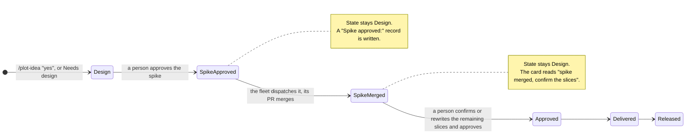
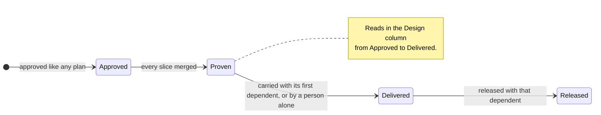

# Workflow phases — design spec

The phases of a team's workflow are configuration. Plot knows plan states, story statuses and three plan markers, and a declared mapping turns those facts into the board's phases. Plot ships the five phases of the agentic workflow as the default.

> **Story:** [Plot works in five phases](STORY-plot-works-in-five-phases.md)
>
> **Decisions:** every decision in this spec is one of the thirty-six that jwloka made on 2026-10-12 and 2026-10-13, numbered as in the story's Decisions table (D1 to D36). A detail that no decision settles is marked *proposed* and listed in the story's Open Points.

## Contents

| § | Section | Answers |
|---|---|---|
| 1 | [Today's state](#1-todays-state) | what the code does on `main` at `75f093cb9` |
| 2 | [The phase model](#2-the-phase-model) | the config key, its format, the default, who reads it |
| 3 | [State to phase](#3-state-to-phase) | where each plan state and story status renders |
| 4 | [Design work](#4-design-work) | the optional Design phase, the spike and the tracer bullet |
| 5 | [The three tabs](#5-the-three-tabs) | Discovery, Planning and Delivery, with lanes, filters and toggles |
| 6 | [The fleet's work](#6-the-fleets-work) | what the fleet does in Design and in Testing |
| 7 | [What stays human](#7-what-stays-human) | approval, release, the spike and the design decision |
| 8 | [Domain rules](#8-domain-rules) | the new and changed rules, per plan |
| 9 | [Out of scope](#9-out-of-scope) | what this story does not change |

## 1. Today's state

Measured on `main` at `75f093cb9`, 2026-10-12.

- `packages/domain/src/entities/workflow.ts:35` declares `BOARD_PHASES = ['Discovery', 'Design', 'Development', 'Testing', 'Released']` as a constant. `PHASE_LEADERSHIP` (`:62`) and `PHASE_WORKFLOWS` (`:143`) are records keyed by those five names.
- `rules/phase.ts:41` `toBoardPhase` maps `draft` to Discovery, `design` to Design, `approved` to Development, `delivered` to Testing and `released` to Released, and `rejected` and `superseded` to `null`. `rules/phase.ts:72` `storyPhase` maps story `draft` to Discovery, `ready` to Design, `active` and `paused` to Development, `in-review` to Testing and `done` to Released. `rules/phase.ts:99` `rowPhase` composes `toBoardPhase`.
- `packages/board/src/server/board.ts:2082-2117` moves a plan whose `planStatus` (`rules/phase.ts:147`) is `deliverable` into the column of `toBoardPhase('delivered')`.
- Seven plan states exist: `draft`, `design`, `approved`, `delivered`, `released`, `rejected`, `superseded` (`transitions/plan.ts:22`, `entities/plan.ts:100-118`, `rules/phase-gate.ts:4-20`). `skills/plot/scripts/plot-plan-meta.sh:94` documents `design` as a phase of its own, and `:246` reads a `Design:` record.
- No command writes `State: Design`. The state gate admits a change of `State:` only when a receipt for that path and value exists (`packages/board/src/server/entry/gate.ts:248-253`), and no command writes a receipt for `Design`, so a commit that changes `Draft` to `Design` in an existing plan is refused. `owningCommand` (`rules/state-transition.ts:93-105`) only builds the refusal text, which names `/plot-approve` and `/plot-deliver`. The board's *Commission design* route (`packages/board/src/server/commission.ts:136-177`) asks an agent to make that edit and to add an empty `## Spec` section.
- The board has three tabs, `stories`, `plans` and `agents` (`packages/board/src/app/App.tsx:118`, `?tab=`; `?tab=board` redirects to `plans`).
- The tracker port lists open issues only (`ports/tracker.ts:108`). `Issue` carries no assignee and no closing date by stated design (`entities/issue.ts:21-23`), and the status write refuses to widen to a label or an assignee (`ports/tracker.ts:31-41`).
- The fleet dispatches `approved` plans only (`rules/eligible.ts:43`) and treats `delivered` and `released` as finished (`rules/eligible.ts:61`).

## 2. The phase model

### What Plot knows

Plot knows three kinds of fact, and only these (D12):

| Fact | Values | Where it is written |
|---|---|---|
| Plan state | `draft`, `design`, `approved`, `delivered`, `released`, `rejected`, `superseded` | `State:` in the plan's `## Status` block |
| Story status | `draft`, `ready`, `active`, `in-review`, `paused`, `done` | `status:` in the story's front matter |
| Plan marker | `design` (the state itself), `spike` (on one slice), `Tracer: yes` (on the plan, D15) | the plan file, see §4 |

A phase name is not a Plot fact. It comes from the operator's workflow.

### The key

A `## Plot Config` key declares the phases (D12). The key name is `Workflow phases`, and its value is one line in the grammar below (D25).

```markdown
- **Workflow phases:** Discovery = story:*; Design = plan:draft, plan:design; Development = plan:approved; Testing = plan:delivered; Released = plan:released
```

- Entries are separated by `;`. The order of the entries is the order of the board's columns.
- Each entry is `<phase name> = <member>, <member>, …`.
- A member is `plan:<state>` or `story:<status>`. `story:*` means every story status. The prefix is required, because `draft` is both a plan state and a story status.
- Each plan state and each story status belongs to at most one phase. A state or status that no phase holds is not on the board.
- `plan:rejected` and `plan:superseded` cannot be declared. They stay off the board (D2).
- A phase name is any text without `;`, `=` or `,`. A name outside the five default names is valid, and nothing refuses it (D26).

The shape follows `Local checks`, whose `;`-separated `pattern = command` value `rules/local-checks.ts:73-82` parses as a value. The two parsers share only the split: `parseLocalChecks` skips a malformed entry, and `parsePhaseMap` refuses it.

### The default

A repository that declares no `Workflow phases` key gets the five phases of the agentic workflow (D1, D2, D12). The default is the value shown above. Plot's own `CLAUDE.md` declares the same value explicitly (D12).

### A declaration that does not parse

The parse rule returns either a phase map or a refusal that names the entry and the reason (for example `plan:approved is in two phases: Development, Testing`). On a refusal the board renders the default map and shows the refusal text above the columns. It never renders a partial map.

### Who reads it

| Reader | Reads | Never reads |
|---|---|---|
| The board server | the key, through the plan store's `config(key, fallback)` | — |
| The domain | the parsed map, as a value (`phaseOfPlan(map, readings)`) | the key text or the config port |
| The fleet | plan states, story statuses and markers | phase names (D12) |
| The skills | plan states | phase names |

The domain rule takes readings as values, as CLAUDE.md's note on shape requires: the board reads the key, the domain parses and answers, and no rule awaits a port.

`PHASE_LEADERSHIP` stays keyed by the five default names. A declared phase whose name is not one of them renders as a column with no leadership badge and a neutral accent (D26). `PHASE_WORKFLOWS` is derived from the map: a lifecycle workflow belongs to the first declared phase that holds a state it acts on. `approve` acts on `draft` and `design`, `dispatch`, `implement` and `deliver` act on `approved`, and `release` acts on `delivered`. With the default map, `approve` belongs to Design, `dispatch`, `implement` and `deliver` to Development, and `release` to Testing, which is the assignment the constant holds today.

## 3. State to phase

### Plans

With the default map (D2):

| Plan state | Phase | Change from today |
|---|---|---|
| `draft` | Design | was Discovery |
| `design` | Design | — |
| `approved` | Development | — |
| `delivered` | Testing | — |
| `released` | Released | — |
| `rejected`, `superseded` | not on the board | — |

Three readings refine the state, in this order:

1. **A tracer plan** (`Tracer: yes`, D15) reads in the phase that holds `plan:design`, in every state but `released` (D5, D14). It never reads in Development or Testing.
2. **A deliverable plan** (`planStatus` is `deliverable`: approved, every non-deferred slice merged) reads in the phase that holds `plan:delivered`. This is today's auto-bump, expressed against the map. The plan file does not change.
3. **Every other plan** reads in the phase that holds its state.

The plan file keeps its state words. Only the mapping changes (D2).

### Stories

With the default map every story status is in Discovery (D1). Discovery holds only stories, and plans move through Design, Development, Testing and Released. Stories stay in Discovery whatever the map says (D27): with a custom map that puts a story status into a phase that also holds plan states, the Discovery tab still lists every story, and the Planning tab shows plans only. The map decides only which empty story lanes the Discovery tab draws.

| Story status | Phase | Change from today |
|---|---|---|
| `draft` | Discovery | — |
| `ready` | Discovery | was Design |
| `active`, `paused` | Discovery | was Development |
| `in-review` | Discovery | was Testing |
| `done` | Discovery | was Released |

## 4. Design work

### The Design phase is optional

Only a plan with significant design decisions gets design work (D3). Design work is two things: a design spec, written in the plan's `## Spec` section, and a spike slice that runs before the remaining slices are confirmed. A Draft plan with no design work also reads in the Design column, where it waits for approval (D3).

A plan enters `State: Design` in two ways, and the fleet decides neither (D3):

- **At creation.** A `/plot-idea` step after the two ceremony questions asks *"Does this plan carry significant design decisions?"* The answer is a `State:`, not a ceremony answer, so the ceremony questions stay at two. On yes the step writes `State: Design` and an empty `## Spec` section instead of `State: Draft`. A new file passes the state gate, because the gate admits a creation.
- **Later.** A person runs the *Needs design* controller action on a Draft plan (the board shows it as a *Needs design* button). The action moves `Draft` to `Design`, writes a `Design:` record (`<date>, <who>, <channel>`, the shape of `Approved:`, in the field `plot-plan-meta.sh:246` already reads), and adds the empty `## Spec` section. Its bundle and endpoint write a state receipt for `Design` through `recordStateReceipt` (`server/entry/ladder.ts:64`), and that receipt admits the commit at the state gate. `owningCommand` gains a `design` arm that names the action in the refusal text; it admits nothing.

An empty spec is a `## Spec` section that is absent or holds only the placeholder `_To be filled in during Design._`, which is the shape *Commission design* writes today (`commission.ts:136-177`).

### The spike

A plan in Design names one slice as its spike (D4), with an annotation on the branch line in the shape of `waits:` and `agent:`:

```markdown
- `feature/the-seam-holds` <!-- spike --> — prove the seam against the real host
```

The spike is the sole branch under the first slice heading. Approving the spike refuses `spike-not-first` otherwise, so every later slice reads `unapproved` until the plan is approved.

**Landing order.** `design-work-proves-the-path` builds this machinery spike-first. Its own spike, `feature/the-design-approvals-are-gated`, lands the person arm and the state gate fix of #1611 first. The `Spike approved:` record and the gate that holds it land later, with the spike approval slice `feature/the-spike-is-approved-alone`. Until the machinery ships, a spike-first plan is approved whole, and a `.plot/hold` line is written for each of its branches except the spike right after the approval, because the approval clears the plan's holds (D29). A person removes the holds once the spike's Acceptance holds in CI. No command writes a `.plot/hold` line today.



- **A person approves the spike alone.** The approval is the `--spike` mode of the approve controller, `board/plot-approve.mjs --spike <slug> --who <handle>` or `POST /api/approve` with `"spike": true`, under the `approve` action, so no new controller action exists. It needs a named person from `People` on every review channel. It writes a `Spike approved:` record (`<date>, <who>, <channel>`) and leaves `State: Design`. For a `Review: pr` plan it merges the plan PR, so the plan with `State: Design` and the record reaches the default branch, where the fleet reads it (D13). The spike slice becomes dispatchable. Every other slice of the plan stays undispatchable.
- **A gate holds the record.** The state gate extends from the `State:` line to the `Spike approved:` record, and refuses a commit that adds, changes or removes the record without the receipt the spike approval leaves. The receipt is keyed `<plan path>#Spike approved`, so a `State:` receipt never admits the record and the record's receipt never admits a `State:` change.
- **The fleet dispatches the spike like any slice** (D4, D10). Its PR is real code, and it lands on the default branch. Five places refuse a slice of a plan that is not `approved` today: `sliceVerdict`, the dispatch workflow's `plangate`, the shell `case` in `plot-dispatch.sh`, the brief route of `implement`, and the commit-time `phaseGateRefusal`. `feature/a-slice-is-marked-spike` deletes the shell `case`, and `plot-dispatch.sh` then asks `plangate`. So four places in TypeScript admit the approved spike and nothing else of the plan, and `plot-dispatch.sh` follows `plangate`.
- **The plan stays in Design after the merge.** A person then confirms the remaining slices, or rewrites them, and approves the plan. The second approval is a person's act on every review channel: a plan in `State: Design` approves through the person arm, with `--who` from `People`, even when its `Review:` field reads `pr` and its plan PR has merged (D10, D13). The arm keys on the `design` state, not on the `Spike approved:` record. The state gate holds that state once the spike of `design-work-proves-the-path` fixes #1611 and the same-slug rename; a `Review: ballot` plan keeps its tally. The approval writes the usual `Approved:` record and no second record, and the plan moves to Development.
- **Approval refuses a plan whose spike has not merged.** The reading is the host's `mergedAt` for the spike's PR. The refusal names the two ways forward: wait for the spike's merge, or remove the `spike` annotation.
- **A release cut while the plan is in Design** ships the spike's changeset, and the release cross-check lists it as a spike of a Design plan (D16).
- **A plan dropped after its spike merged** keeps the spike's code on the default branch. A revert is a slice of a new plan (D17).

### The tracer bullet

A tracer-bullet plan is a full plan that proves a path other plans need (D5). It carries a `Tracer: yes` line in its `## Status` block, and its `Type:` keeps `feature`, `bug`, `docs` or `infra` (D15).

- It is approved and dispatched like any plan.
- It reads in the Design column in every state but `released` (§3).
- When all its slices merge, its status reads `proven`.
- A dependent plan waits on it through the existing `waits:` annotation (`docs/plans/2026-09-01-a-slice-can-wait-on-another-plan.md`): a dependent slice names a tracer branch, and the merge of that branch unblocks it. This mechanism needs no change.
- It is released with the first dependent that ships (D5). Automatic delivery skips a tracer plan on its own. When automatic delivery or `/plot-deliver` delivers a plan with a slice that waits on a branch of a proven tracer plan, it carries that tracer plan in the same step, and the next release carries both. The deliver workflow writes `State: Delivered` into both plan files, so it records a second state receipt, one per plan file.
- A person may deliver a proven tracer plan that has no dependent alone (D14). It stays in the Design column until it is released.



## 5. The three tabs

The board has three tabs, Discovery, Planning and Delivery (D6). The names are fixed in the board and no config key changes them.

| Tab | URL | Replaces | Old URLs that redirect |
|---|---|---|---|
| Discovery | `?tab=discovery` | Stories | `?tab=stories` |
| Planning | `?tab=planning` | Plans | `?tab=plans`, `?tab=board` |
| Delivery | `?tab=delivery` | Agents | `?tab=agents` |

### Discovery

The Discovery tab shows the tag cloud, a tickets lane group and a stories lane group, as separate lanes (D7).

**Ticket lanes.** Open, In progress and Done. A ticket's lane comes from the tracker's own status category first, which only Jira states. `plot-host.sh issue-list` derives a category for GitHub and Bitbucket from the state it asks for (every open GitHub issue reads `To Do`, `:4730-4736`), and the lane ignores a derived category, so those trackers read as having none:

| Ticket | Lane |
|---|---|
| stated category `To Do` | Open |
| stated category `In Progress` | In progress |
| stated category `Done` | Done |
| no stated category, open, no plan's `Issue:` names it | Open |
| no stated category, open, a plan's `Issue:` names it | In progress |
| no stated category, closed | Done |

The issue index keeps the tickets closed in the last 14 days (D19). The Done lane shows the 20 most recently closed of them and a *show all done* link that shows the rest (D24). On this repository 154 of 194 closed issues fall inside 14 days, so the window alone does not bound the lane.

**Story lanes.** Draft holds `draft`, `ready` and `paused`. Active holds `active` and `in-review`. Done holds `done` stories that are not archived. *Archived* is the location: a story under `<Story directory>/archived/`, the directory the `Story directory` key names (`docs/stories/` by default). A story whose derived standing is `archived`, because every plan of it is released, is not a status a map can declare, and it reads in Done.

**The archived toggle.** One tab-wide toggle shows archived and closed items: an Archived lane with every archived story, and every closed ticket in Done. The tab keeps it per viewer in `?archived=1`. The Planning tab keeps `?released=1` for *Show released*, so the two toggles stay two (`App.tsx:633-638` keeps every parameter on a tab switch).

**Retention (D19).** The tracker port lists closed issues. The issue index holds the open tickets and the tickets closed in the last 14 days, and the board reads them through the index (D7). With the toggle on, the tab reads every closed ticket from the host on demand, capped at 1000, and that answer is not written to the index. The fleet stays the index's one writer.

**The issue gate (D28).** fleetd reads the issues on a gate of its own, at most 30 requests an hour per repository: a pass of `n` requests opens the gate again after `max(120 s, n × 120 s)`. The issue index file `issues.json` carries the gate with the rows: `nextAt`, `backoffUntil`, the last pass's request count, and the connector and account the pass spent. fleetd is its one writer, and no new channel carries the gate. Two readers read it:

- **The PR pass** holds its own gate until `backoffUntil` where the issue pass spent its own connector and account, and never moves its gate earlier. It subtracts the issue pass's spend from the rate its cadence divides by under the same condition, and the spend banner keeps the account's whole rate. A Jira source spends the Jira account, so the PR pass neither subtracts it nor shares its backoff.
- **The board** reads the gate to pace the archived toggle's closed read and to hold it during a backoff. With no fleet, the board keeps the same fields in memory and writes no file.

**Scope (D20, D23, D30).** On Jira the lanes show every ticket of the declared projects, not only the current user's: the lanes' open and closed reads drop the `assignee = currentUser()` clause that the Jira inbox reads today (`plot-host.sh:4684`). The project-wide read needs `Ticket prefixes`: with none declared, the open read keeps today's query and the lanes show the reader's own tickets, because an unscoped read without the person clause covers the whole Jira instance. The inbox keeps today's read beside the lanes read (D23, *Delivery* below). The drop lands only after the Delivery tab's assignee filter exists. The inbox read rides the issue pass, on the same gate (D30): its page counts in the pass's requests, so the Jira spend stays at most 30 requests an hour, and on a project with 1000 open tickets the pass, and the inbox with it, runs about every 22 minutes.

### Planning

The Planning tab keeps the sprint filter, the story filter, the *Story lanes* toggle and *Only my work* (D8). Its columns are the declared phases that hold plan states, in declared order, and it shows plans only, never a story (D27). With the default map those are Design, Development and Testing. A *Show released* checkbox, off by default, adds the phase that holds `plan:released`.

### Delivery

The Delivery tab is today's Agents tab (D9).

- **Waiting on you** keeps today's content: tickets, broken agents, Draft plans with no branch, and a failed verification run (§6). By default its ticket rows show only tickets assigned to the current user. This needs the tracker's assignee on `Issue`, a read the entity refuses today (§1). D9 decides the read. Today the Jira rows are the user's only because the query reads `assignee = currentUser()`. After D20 the lanes' list is project-wide, so D9's default is a filter on `Issue.assignee` for a reader that `People` matches. For a reader it does not match, the Jira inbox keeps today's `assignee = currentUser()` read (D23). The Delivery inbox does not read the project-wide list before that filter exists.
- **The assignee match (D21).** `People` keeps its form `handle = Spelling, Spelling; handle = Spelling` (`entities/person.ts:75` `parsePersonDirectory`), and a tracker account is one more spelling with a tracker prefix: `jwloka = Jan Wloka, jira:jan.wloka@quatico.com`. A spelling whose text before the first `:` names a tracker (`jira`) is that tracker's account. Today's parser already reads such a spelling as a spelling of the handle, so every existing `login = Name` entry keeps its meaning, and `plot-config.sh get People` and the config port's `config('People', '')` return the raw value unchanged; the domain parses it. The form is a comma spelling and not `Jan Wloka <jira:…>`, because today's parser would read `jan wloka <jira:…>` as one spelling and the display name `Jan Wloka` would stop resolving. The reader is the host login, resolved to a handle through `People`. A GitHub or Bitbucket assignee is a host login and resolves the same way. A Jira assignee resolves through the `jira:` spelling, and the Jira connector reads the assignee's `emailAddress`, or its `accountId` where Jira hides the email. The ticket is the reader's when both resolve to one handle.
- **An unmatched reader (D22, D23).** On a GitHub or Bitbucket source, when the reader's host login resolves to no declared handle, or the source states no assignee (Bitbucket's `bb issue list` prints none), *Waiting on you* shows every ticket, as today, and a sentence that names the missing match, for example *jwloka is not declared in `People` — showing every ticket.* Nothing is hidden silently. On a Jira source, when the reader's handle has no `jira:` spelling, *Waiting on you* shows the rows of today's `assignee = currentUser()` read, with no notice (D23), so a Jira inbox never widens at upgrade.
- **Active sprint** is a button that selects every Active sprint in the existing sprint multiselect (D32). It adds no second scope rule: the tab shows the plans of the selected sprints and their items, PRs, branches, builds and agents, through the multiselect's own filter.
- **Only my work** filters tickets, branches, PRs, plans and builds associated with the current user.

## 6. The fleet's work

The fleet reads plan states and markers. It never reads a phase name (D12).

### In Design

- **The spec.** For a plan in `State: Design` whose spec is empty, the fleet commissions an agent to write the spec (D10). This is today's *Commission design* agent, started by the fleet instead of a button, with a prompt that writes the spec instead of an empty section.
- **The spike.** After a person approves a spike, the fleet dispatches it (D10). Automatic dispatch reads the `Spike approved:` record and the `spike` marker as the eligibility of that one slice.
- **The approval stays a person's act** (D10). The fleet approves no spike and no plan.

### In Testing

For each Delivered plan the fleet runs a verification panel against the merged work on the default branch (D11). This includes a plan that `/plot-deliver` step 5 already panelled at delivery, which the fleet verifies again (D18). A tracer plan (`Tracer: yes`) never reads in Testing (§3), so the fleet starts no run for it, and the claims it carries are judged where its first dependent's Changelog states them.

1. **The pinned commit.** A run judges the plan at its delivery commit, the commit on the default branch that added the `Delivered:` record, in a detached worktree. The pin narrows the window in which a later plan can refute a claim, and does not close it: a plan delivered later can merge a slice before the pin. The run executes the default branch's scripts, bundles and skill text against the pinned code, and reads only the plan, its code and its `## Plot Config` at the pinned commit. The record names the delivery commit, the judged commit and the tools commit.
2. **The claims.** Each Changelog entry and acceptance claim of the plan is one claim. The run is `/plot-deliver --verify <slug>`, which uses step 5's lenses, rubric and the vocabulary `supported` and `refuted` through the `plot-panel` mechanism. Each juror commits one gated label per claim, shown to the juror as `Claim-<n>: <supported|refuted>`, beside step 5's `Position` and `Evidence` lines. A line pasted from that form fails the gate, because `<supported|refuted>` is not a word in the vocabulary. `/plot-panel`'s Commitment parameter becomes a list of labels: it checks each label per juror and sends a juror back once with every refusal of that juror, so a juror that omits a label is asked again for it. A juror still refused after the send-back makes the run fail. A domain fold gives one line per claim, and one refutation decides.
3. **The record.** The fleet writes a `Verified:` line in `## Status` and a `## Verification` section with one line per claim. The record names the delivery it judged, by its `Delivered:` date and commit. `/plot-reject` replaces `Delivered:` with `Rejected:` and keeps the record, so the record reads `stale` when the plan's current `Delivered:` value differs from it or is absent, and the fleet verifies a `stale` plan again after its next delivery.
4. **The issues.** The fleet opens one issue per refuted claim, labelled `ai-generated`, through the tracker port. This is a new write to a tracker, which D11 decides. The port resolves through the issue source (`trackerForIssues`), and the git host's issue connector is read-only, so a repository with no `Tracker` key answers `unaskable` and opens nothing. This repository declares no `Tracker` key, so its own runs open no issue, and the claim's line says so.
5. **The flag.** A plan with a refuted claim is flagged on the board, and `/plot-release` lists it before a cut. A failed run shows in *Waiting on you*.
6. **The checklist.** The fleet keeps a manual release checklist for the endgame round of human testing in `docs/releases/vnext-checklist.md`, in the shape of the checklist `/plot-release rc` writes to `docs/releases/v<version>-checklist.md`. `/plot-release rc` adds its RC line to `vnext-checklist.md` in place and keeps the name, and from that line on the fleet leaves the file alone. The final `/plot-release` renames it to `docs/releases/v<version>-checklist.md`.

Two `## Plot Config` keys govern the run. `Verify command` names the runner, and an absent key starts nothing. `Auto-verify` turns the run on, and it defaults off. The fleet runs one verification at a time. A domain rule `verifyStart` decides whether a pass starts a run: it starts one when no slice waits for a free agent in that pass and the machine has headroom for one more process, and while the run goes the fleet counts it in `running`, so it starts one slice agent fewer. The machine therefore runs at most `Parallel agents` + 1 processes, and the verify process holds 4 Frontier contexts, a moderator and three jurors. The fleet never re-runs a plan whose record is current, and it runs a `stale` one; a person re-verifies with `/plot-deliver --verify <slug> [--at <sha>]`.

Release stays a person's act (D11). The fleet fills no sign-off line, which `/plot-release` already forbids an agent.

## 7. What stays human

| Act | Who | Decision |
|---|---|---|
| Deciding that a plan needs design | a person, at `/plot-idea` or with *Needs design* | D3 |
| Approving a spike | a person | D4 |
| Removing the holds of a spike-first plan approved whole | a person | D29 |
| Confirming the slices after a spike and approving the plan | a person | D4, D10 |
| Approving any plan | a person | D10 |
| Delivering a tracer plan with no dependent | a person | D14 |
| Re-verifying a recorded plan | a person, with `/plot-deliver --verify` | D11, D18 |
| Releasing | a person | D11 |
| Declaring the phases | the operator, in `## Plot Config` | D12 |

## 8. Domain rules

Every view state in this story is a domain property, per CLAUDE.md's *Every rendered state is a domain property*.

| Rule | New or changed | Plan |
|---|---|---|
| `parsePhaseMap(value)`, `DEFAULT_PHASE_MAP`, `planPhases(map)` | new | `the-phases-are-declared` |
| `phaseOfPlan(map, readings)`, `phaseOfStory(map, status)` | new; replace `toBoardPhase` and `storyPhase` | `the-phases-are-declared` |
| `phaseWorkflows(map)` | new; replaces the `PHASE_WORKFLOWS` constant | `the-phases-are-declared` |
| `needsDesign(plan, input)` | new transition, `draft` to `design` | `the-phases-are-declared` |
| `owningCommand` | changed; names *Needs design* for `design` in the refusal text; the state receipt admits the write | `the-phases-are-declared` |
| `spikeOf(slices)`, `approveSpike(plan, input)`, `spikeApprovalOf(text)`, `approvalArm({ phase, review })` | new | `design-work-proves-the-path` |
| `approve` | changed; refuses `spike-unmerged`; a `design` plan takes the person arm | `design-work-proves-the-path` |
| `sliceVerdict` | changed; an approved spike of a Design plan is dispatchable | `design-work-proves-the-path` |
| `planStatus` | changed; adds `proven` for a tracer plan | `design-work-proves-the-path` |
| `phaseGateRefusal`, `plangate` | changed; admit the approved spike branch of a Design plan | `design-work-proves-the-path` |
| `boardTabOf(param)` | new | `the-board-has-three-tabs` |
| `planningColumns(columns, showReleased)`, `revealsReleased(columns, slug)` | new | `the-board-has-three-tabs` |
| `assigneeHandle(assignee, source, directory)` | new; reads `People` tracker spellings | `the-board-has-three-tabs` |
| `waitingTickets(issues, inbox, reader, directory, source)`, `activeSprintButton(sprints)` | new; `waitingTickets` answers the tickets and, on GitHub and Bitbucket, an unmatched-reader notice | `the-board-has-three-tabs` |
| `ticketLane(issue, reading, now)`, `storyLanes(map)`, `storyLane(map, standing, location)` | new | `tickets-and-stories-have-lanes` |
| `trackerForIssues(declared, gitHost, context)` | new adapter resolver | `tickets-and-stories-have-lanes` |
| `specIsEmpty(planText)`, `designWork(plan)` | new | `the-fleet-writes-the-design` |
| `claimsOf(plan)`, the refs operation `recordCommit(file, field)`, `verificationOf(plan, deliveryCommit)`, `refutedClaims(record)`, `foldVerification(claims, jurors)`, `verifyStart(readings)`, `verificationRow(plan, runState)` | new | `the-fleet-verifies-what-it-delivered` |

## 9. Out of scope

- **Renaming plan states.** Plan files keep `Draft`, `Design`, `Approved`, `Delivered` and `Released` (D2). No plan file changes.
- **Configurable tab names.** The three tab names are fixed (D6).
- **A fleet that decides design.** The fleet never moves a plan into Design and never approves (D3, D10).
- **A fleet that releases.** Release stays a person's act (D11).
- **New story statuses.** The six statuses stay. The story lanes group them (D7).
- **Sprint states.** `Planning`, `Committed`, `Active` and `Closed` (`entities/sprint.ts:9`) are not phases and are not in the map.
